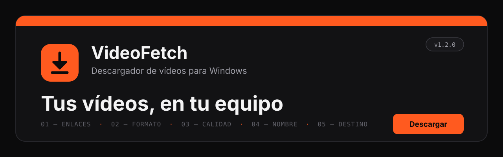
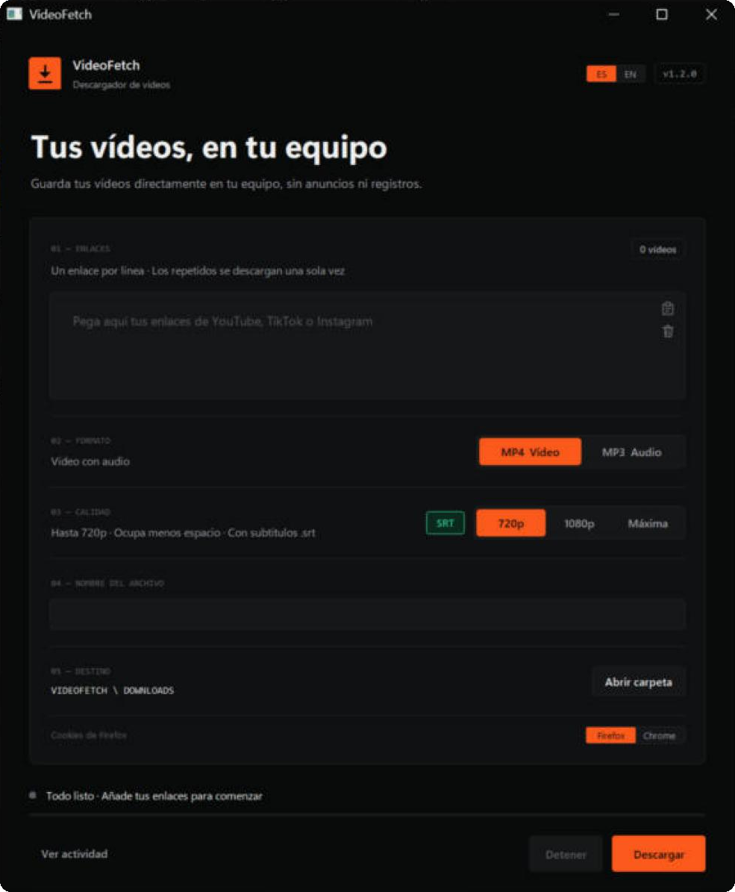

<p align="center">
  
</p>

<p align="center">
  <a href="README.md">English</a> · <b>Español</b>
</p>

<p align="center">
  
  
  
  
</p>

<p align="center">
  <b>Descargador de vídeos de escritorio para Windows, con ventana propia.</b><br>
  Pega los enlaces, elige formato y calidad, y pulsa <b>Descargar</b>.<br>
  Sin anuncios y sin registros: los archivos se guardan directamente en tu equipo.
</p>

<p align="center">
  
</p>

---

## Índice

- [Qué hace](#qué-hace)
- [Requisitos](#requisitos)
- [Instalación](#instalación)
- [Cómo se usa](#cómo-se-usa)
- [Nombres de los archivos](#nombres-de-los-archivos)
- [Si una descarga falla](#si-una-descarga-falla)
- [Estructura del proyecto](#estructura-del-proyecto)
- [Tecnologías](#tecnologías)
- [Diseño](#diseño)
- [Próximamente](#próximamente)
- [Uso responsable](#uso-responsable)
- [Autores](#autores)
- [Licencia](#licencia)

---

## Qué hace

| | |
|---|---|
| **Webs** | YouTube, TikTok, Instagram, X, Facebook, Vimeo, Twitch y todas las que admite [yt-dlp](https://github.com/yt-dlp/yt-dlp). |
| **Varios enlaces a la vez** | Un enlace por línea. Los repetidos se descargan una sola vez. |
| **Formato** | **MP4** (vídeo con audio) o **MP3** (solo audio, con la miniatura como carátula). |
| **Calidad** | **720p**, **1080p** o **Máxima** (4K si el vídeo lo tiene). Funciona igual con vídeos horizontales y verticales. |
| **Listo para editar** | Los MP4 salen siempre en **H.264 + AAC**, el formato que abren Sony Vegas, Premiere y DaVinci Resolve, y del que Windows muestra la miniatura. Si la web lo da en otro formato, se convierte al terminar (usa la tarjeta gráfica NVIDIA, Intel o AMD si la hay). |
| **Subtítulos (SRT)** | Con el botón **SRT** encendido, también te llevas `nombre.srt` en el idioma de la ventana. Usa los subtítulos de la web si los hay (YouTube, incluida su traducción automática, y TikTok); si no (Instagram, X…), **los crea con IA (Whisper)** en tu equipo y los traduce si hace falta (la traducción usa Google Traductor: solo se envía por Internet el texto de los subtítulos). |
| **Una sola pista de audio** | Si el vídeo trae varias pistas, se queda solo la principal. |
| **Idioma** | Ventana en **español** o **inglés**: botones **ES / EN** arriba, junto a la versión. La primera vez usa el idioma de Windows y después recuerda tu elección. |
| **Actividad** | El botón *Ver actividad* muestra el progreso, la resolución conseguida y los avisos. Se puede detener en cualquier momento. |

## Requisitos

- **Windows 10 u 11**
- **[Python 3.13](https://www.python.org/downloads/)** (marca *Add Python to PATH* al instalarlo)
- **[FFmpeg](https://ffmpeg.org/download.html)** (con `ffprobe`) en el PATH
- **[Node.js](https://nodejs.org/)** en el PATH (lo usa yt-dlp para algunos vídeos de YouTube)
- Conexión a Internet
- *(Botón SRT)* unos 700 MB más de espacio: `02_ACTUALIZAR.cmd` instala Whisper y el modelo de IA (~500 MB) se descarga la primera vez que se usa. Con tarjeta NVIDIA va mucho más rápido, pero no es obligatoria.

## Instalación

1. Descarga el proyecto: botón verde **Code → Download ZIP**, o la última versión en **[Releases](../../releases)**.
2. Descomprímelo donde quieras. La carpeta se puede mover: todas las rutas son relativas.
3. Abre **`02_ACTUALIZAR.cmd`** una vez. Instala yt-dlp y sus piezas en la carpeta `SISTEMA\`.
4. Abre **`01_DESCARGAR.cmd`** y se abrirá la ventana.
5. *(Opcional)* Abre **`03_CREAR_ACCESO_DIRECTO.cmd`** para tener VideoFetch en el escritorio con su icono.

> [!TIP]
> Si te saltas el paso 3, `01_DESCARGAR.cmd` se da cuenta de que falta yt-dlp y te ofrece instalarlo.

## Cómo se usa

1. **01 · Enlaces**: pega un enlace por línea. Dentro del cuadro tienes los iconos de *pegar* y *limpiar*.
2. **02 · Formato**: MP4 o MP3.
3. **03 · Calidad**: 720p, 1080p o Máxima (solo en MP4). El botón pequeño **SRT** de al lado: en verde = guarda también los subtítulos en `.srt`.
4. **04 · Nombre del archivo** *(opcional)*: una casilla por enlace. Vacía = nombre automático.
5. **05 · Destino**: la carpeta `DOWNLOADS\`, dentro de VideoFetch.
6. Pulsa **Descargar** (o `Ctrl + Enter`). Al terminar, **Abrir carpeta** te lleva a los archivos.
7. **ES / EN** (arriba a la derecha) cambia el idioma al momento, sin perder lo que hayas escrito.

También funciona desde la consola:

```bat
python APP\descargador.py
python APP\descargador.py --lang en
python APP\descargador.py --srt
```

## Nombres de los archivos

| Web | Nombre | Ejemplo |
|---|---|---|
| YouTube y otras | Título del vídeo | `Mi vídeo.mp4` |
| TikTok, Instagram, X, Facebook | Usuario con @ | `@usuario.mp4` |

- **Nunca sobrescribe**: si el nombre ya existe, el primero pasa a `_01` y los nuevos son `_02`, `_03`…
- El MP3 y el MP4 de un mismo vídeo pueden compartir nombre.
- Los subtítulos llevan el mismo nombre que el vídeo: `Mi vídeo.mp4` + `Mi vídeo.srt`.

## Si una descarga falla

VideoFetch lo reintenta solo, en este orden:

1. **Normal**, sin cookies.
2. **Modo incógnito** (redes sociales): sin datos guardados e imitando a Chrome con `curl_cffi`.
3. **Con tu sesión del navegador** (Firefox o Chrome, se elige en la ventana): para vídeos con edad, solo para miembros o directos recién terminados.

VideoFetch no guarda ni envía contraseñas: solo usa la sesión abierta en tu equipo. Si YouTube cambia algo y deja de funcionar, abre `02_ACTUALIZAR.cmd`.

Si la ventana da algún error, queda apuntado en `APP\videofetch_errores.log`.

## Estructura del proyecto

```
VIDEOFETCH
├── 00_LEEME.txt                  Instrucciones rápidas
├── 00_README_EN.txt              Instrucciones rápidas en inglés
├── 01_DESCARGAR.cmd              Abre la ventana
├── 02_ACTUALIZAR.cmd             Instala / actualiza yt-dlp en SISTEMA\
├── 03_CREAR_ACCESO_DIRECTO.cmd   Acceso directo en el escritorio
├── APP\
│   ├── interfaz.py               Ventana (Tkinter)
│   ├── descargador.py            Lógica de descarga (también modo consola)
│   ├── idiomas.py                Todos los textos en español e inglés
│   └── videofetch.ico            Icono
├── DOWNLOADS\                    Aquí se guardan los vídeos
├── SISTEMA\                      yt-dlp, Whisper y dependencias (se crea con 02_ACTUALIZAR)
│   └── modelos_ia\               Modelo de IA de subtítulos (se descarga la primera vez)
├── docs\                         Imágenes del README
├── README.md / README.es.md     Este documento (inglés / español)
├── CHANGELOG.md / CHANGELOG.es.md
├── requirements.txt
└── LICENSE
```

## Tecnologías

| | |
|---|---|
| **Python 3.13** | Lenguaje del programa |
| **Tkinter** | Ventana de escritorio, con diseño propio |
| **yt-dlp** | Descarga desde cientos de webs |
| **FFmpeg** | Unir, convertir y reducir vídeo y audio |
| **curl_cffi** | "Modo incógnito" que imita a Chrome |
| **faster-whisper** | IA que pasa la voz a texto (Whisper) para los subtítulos |
| **deep-translator** | Traducción de los subtítulos |

## Diseño

Fondo grafito monocromo y un solo color de señal, el naranja.

| Color | Uso |
|---|---|
|  `#0B0B0C` | Fondo |
|  `#121214` | Tarjetas |
|  `#F4F4F5` | Texto |
|  `#A1A1AA` | Texto secundario |
|  `#FF5A1F` | Acento: botón *Descargar* y opciones elegidas |

## Próximamente

- [x] Ventana y README en inglés (v1.1.0)
- [x] Comentarios del código en inglés
- [x] Subtítulos SRT, con IA (Whisper) si la web no los da (v1.2.0)
- [ ] GIF de la aplicación en marcha
- [ ] Versión `.exe` que no necesite Python instalado
- [ ] Pruebas automáticas (nombres de archivo, repetidos, elección de calidad)
- [ ] Aviso de nuevas versiones dentro de la ventana

## Uso responsable

VideoFetch es una herramienta para guardar **vídeos propios o con permiso de su autor**.
Respeta los derechos de autor y las normas de cada web. El proyecto **no se salta
protecciones DRM** ni restricciones de acceso: si un vídeo está protegido, lo avisa y no lo descarga.

## Autores

| | Papel | GitHub |
|---|---|---|
| **Juan Bautista Galisteo Marqués** | Autor y responsable del proyecto | [@juangalisteo](https://github.com/juangalisteo) |
| **Juan Manuel Casado Triguero** | Colaborador | [@juanmacasado](https://github.com/juanmacasado) |

## Licencia

Distribuido bajo la **Licencia Pública General de GNU v3.0** (GPL-3.0 o posterior). Consulta el archivo [LICENSE](LICENSE).

Puedes usar, estudiar, compartir y modificar VideoFetch. Si repartes una versión modificada,
también tiene que publicarse bajo la GPL y con su código fuente.

Copyright © 2026 Juan Bautista Galisteo Marqués y Juan Manuel Casado Triguero.
Las versiones 1.0.0 y 1.1.0 se publicaron con licencia MIT.

<p align="center"><sub>VideoFetch v1.2.0 · Juan Bautista Galisteo Marqués y Juan Manuel Casado Triguero</sub></p>
