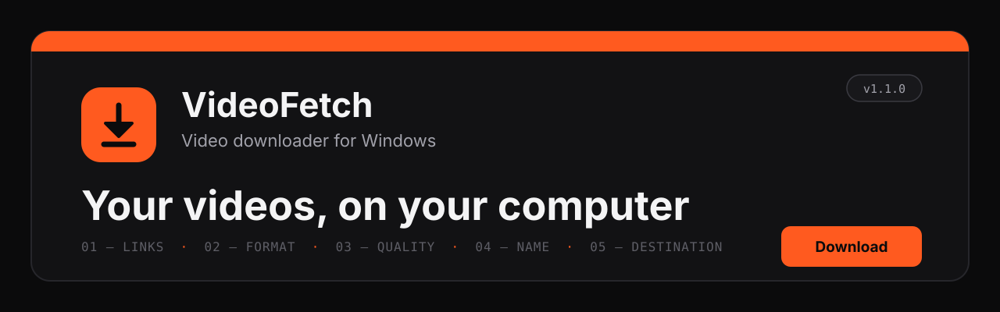
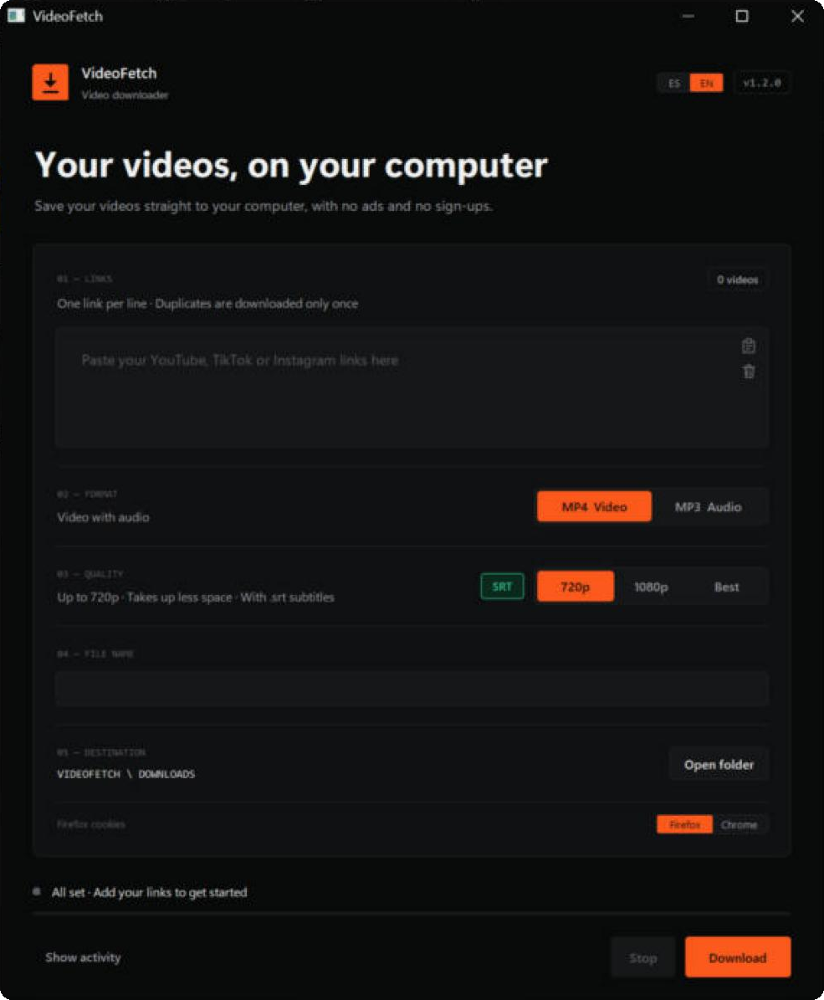

<p align="center">
  
</p>

<p align="center">
  <b>English</b> · <a href="README.es.md">Español</a>
</p>

<p align="center">
  
  
  
  
</p>

<p align="center">
  <b>A desktop video downloader for Windows, with its own window.</b><br>
  Paste your links, pick a format and quality, and press <b>Download</b>.<br>
  No ads and no sign-ups: files are saved straight to your computer.
</p>

<p align="center">
  
</p>

---

## Contents

- [Features](#features)
- [Requirements](#requirements)
- [Installation](#installation)
- [How to use it](#how-to-use-it)
- [File names](#file-names)
- [If a download fails](#if-a-download-fails)
- [Project structure](#project-structure)
- [Tech stack](#tech-stack)
- [Design](#design)
- [Roadmap](#roadmap)
- [Responsible use](#responsible-use)
- [Authors](#authors)
- [License](#license)

---

## Features

| | |
|---|---|
| **Sites** | YouTube, TikTok, Instagram, X, Facebook, Vimeo, Twitch and every site supported by [yt-dlp](https://github.com/yt-dlp/yt-dlp). |
| **Several links at once** | One link per line. Duplicates are downloaded only once. |
| **Format** | **MP4** (video with audio) or **MP3** (audio only, with the thumbnail as cover art). |
| **Quality** | **720p**, **1080p** or **Best** (4K if the video has it). Works the same for horizontal and vertical videos. |
| **Ready to edit** | MP4 files always come out as **H.264 + AAC**, the format Sony Vegas, Premiere and DaVinci Resolve open, and the one Windows shows thumbnails for. If the site serves another format, it is converted at the end (using an NVIDIA, Intel or AMD graphics card when available). |
| **A single audio track** | If the video has several audio tracks, only the main one is kept. |
| **Language** | The window comes in **English** or **Spanish**: **ES / EN** buttons at the top, next to the version. On first launch it follows the Windows language, then remembers your choice. |
| **Activity** | The *Show activity* button displays progress, the resolution obtained and any warnings. You can stop at any time. |

## Requirements

- **Windows 10 or 11**
- **[Python 3.13](https://www.python.org/downloads/)** (tick *Add Python to PATH* when installing it)
- **[FFmpeg](https://ffmpeg.org/download.html)** (with `ffprobe`) on the PATH
- **[Node.js](https://nodejs.org/)** on the PATH (yt-dlp uses it for some YouTube videos)
- An Internet connection

## Installation

1. Download the project: green **Code → Download ZIP** button, or the latest version under **[Releases](../../releases)**.
2. Unzip it wherever you like. The folder can be moved: every path is relative.
3. Run **`02_ACTUALIZAR.cmd`** once. It installs yt-dlp and its parts into the `SISTEMA\` folder.
4. Run **`01_DESCARGAR.cmd`** and the window will open.
5. *(Optional)* Run **`03_CREAR_ACCESO_DIRECTO.cmd`** to get a VideoFetch shortcut with its icon on your desktop.

> [!TIP]
> If you skip step 3, `01_DESCARGAR.cmd` notices that yt-dlp is missing and offers to install it for you.

> [!NOTE]
> The launcher files and folders keep their original Spanish names (`DESCARGAR` = download, `ACTUALIZAR` = update, `CREAR_ACCESO_DIRECTO` = create shortcut, `SISTEMA` = system) so that existing installations keep working.

## How to use it

1. **01 · Links**: paste one link per line. Inside the box you have the *paste* and *clear* icons.
2. **02 · Format**: MP4 or MP3.
3. **03 · Quality**: 720p, 1080p or Best (MP4 only).
4. **04 · File name** *(optional)*: one box per link. Empty = automatic name.
5. **05 · Destination**: the `DOWNLOADS\` folder, inside VideoFetch.
6. Press **Download** (or `Ctrl + Enter`). When it finishes, **Open folder** takes you to the files.
7. **ES / EN** (top right) switches the language instantly, without losing what you typed.

It also works from the console:

```bat
python APP\descargador.py --lang en
```

## File names

| Site | Name | Example |
|---|---|---|
| YouTube and others | Video title | `My video.mp4` |
| TikTok, Instagram, X, Facebook | Username with @ | `@username.mp4` |

- **Never overwrites**: if the name already exists, the first file becomes `_01` and new ones are `_02`, `_03`…
- The MP3 and the MP4 of the same video can share a name.

## If a download fails

VideoFetch retries on its own, in this order:

1. **Normal**, without cookies.
2. **Incognito mode** (social media): no stored data, and imitating Chrome with `curl_cffi`.
3. **With your browser session** (Firefox or Chrome, chosen in the window): for age-restricted or members-only videos, or live streams that just ended.

VideoFetch never stores or sends passwords: it only uses the session already open on your computer. If YouTube changes something and it stops working, run `02_ACTUALIZAR.cmd`.

If the window ever hits an error, it is written to `APP\videofetch_errores.log`.

## Project structure

```
VIDEOFETCH
├── 00_LEEME.txt                  Quick guide (Spanish)
├── 00_README_EN.txt              Quick guide (English)
├── 01_DESCARGAR.cmd              Opens the window
├── 02_ACTUALIZAR.cmd             Installs / updates yt-dlp in SISTEMA\
├── 03_CREAR_ACCESO_DIRECTO.cmd   Desktop shortcut
├── APP\
│   ├── interfaz.py               Window (Tkinter)
│   ├── descargador.py            Download logic (also console mode)
│   ├── idiomas.py                Every text in Spanish and English
│   └── videofetch.ico            Icon
├── DOWNLOADS\                    Downloaded videos go here
├── SISTEMA\                      yt-dlp and dependencies (created by 02_ACTUALIZAR)
├── docs\                         README images
├── README.md / README.es.md      This document (English / Spanish)
├── CHANGELOG.md / CHANGELOG.es.md
├── requirements.txt
└── LICENSE
```

## Tech stack

| | |
|---|---|
| **Python 3.13** | Programming language |
| **Tkinter** | Desktop window, with a custom design |
| **yt-dlp** | Downloads from hundreds of sites |
| **FFmpeg** | Merges, converts and scales video and audio |
| **curl_cffi** | "Incognito mode" that imitates Chrome |

## Design

A monochrome graphite background and a single signal colour: orange.

| Colour | Use |
|---|---|
|  `#0B0B0C` | Background |
|  `#121214` | Cards |
|  `#F4F4F5` | Text |
|  `#A1A1AA` | Secondary text |
|  `#FF5A1F` | Accent: *Download* button and selected options |

## Roadmap

- [x] English window and README (v1.1.0)
- [x] Code comments in English
- [ ] GIF of the app in action
- [ ] `.exe` version that does not need Python installed
- [ ] Automated tests (file names, duplicates, quality selection)
- [ ] New-version notice inside the window

## Responsible use

VideoFetch is a tool for saving **your own videos or videos you have permission to download**.
Respect copyright and each site's terms. The project **does not bypass DRM protection**
or access restrictions: if a video is protected, it tells you and does not download it.

## Authors

| | Role | GitHub |
|---|---|---|
| **Juan Bautista Galisteo Marqués** | Author and project lead | [@juangalisteo](https://github.com/juangalisteo) |
| **Juan Manuel Casado Triguero** | Collaborator | [@juanmacasado](https://github.com/juanmacasado) |

## License

Released under the **MIT** license. See the [LICENSE](LICENSE) file.

<p align="center"><sub>VideoFetch v1.1.0 · Juan Bautista Galisteo Marqués and Juan Manuel Casado Triguero</sub></p>
